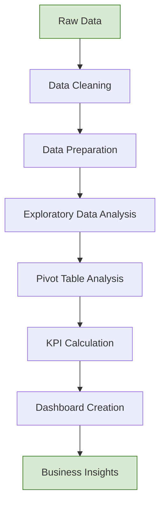

# 📊 Vrinda Store Data Analysis – Excel Dashboard

**An interactive Excel dashboard and sales analysis of Vrinda Store's FY 2022 e-commerce data.**

---

## 📌 1. Project Overview

- Analysed Vrinda Store's FY 2022 sales data.
- Used Microsoft Excel for data cleaning, analysis and visualisation.
- Created Pivot Tables and an interactive dashboard.
- Analysed customer behaviour, sales trends and product performance.
- Presented business information through charts, KPIs and slicers.

## 🎯 2. Project Objectives

- Analyse overall sales performance.
- Calculate total sales, orders and quantity.
- Identify monthly sales trends.
- Analyse category-wise sales.
- Compare different sales channels.
- Understand gender-wise purchasing patterns.
- Analyse age-group-wise sales.
- Identify top-performing states.
- Examine order status and delivery performance.
- Understand return and cancellation patterns.

---

## 🔄 3. Project Workflow

**Raw Data → Data Cleaning → Data Preparation → Data Analysis → Pivot Tables → KPI Calculation → Dashboard Creation → Business Insights**

---

## 🗃️ 4. Dataset Information

The dataset contains the following columns:

- Order ID
- Customer ID
- Gender
- Age
- Age Group
- Date
- Month
- Channel
- Category
- Size
- Quantity
- Amount
- Shipping / Delivery Information
- Order Status
- State

---

## 🧹 5. Data Cleaning

Performed the following data-cleaning activities:

1. Checked dataset structure.
2. Identified available columns.
3. Checked duplicate records.
4. Removed unnecessary duplicates where required.
5. Checked blank and missing values.
6. Verified data types.
7. Corrected date-related fields where required.
8. Standardised categorical values.
9. Checked Amount and Quantity columns.
10. Verified Order Status values.
11. Checked Channel and Category consistency.

**Objective:** Make the dataset clean, consistent and ready for analysis.

---

## 🗂️ 6. Data Preparation

Prepared and organised important fields for analysis:

- Month
- Gender
- Age Group
- Channel
- Category
- Size
- State
- Order Status

---

## 🔍 7. Exploratory Data Analysis (EDA)

Analysed different business dimensions:

**Sales Analysis**
- Total sales amount
- Total orders
- Total quantity sold
- Monthly sales trends

**Customer Analysis**
- Gender-wise sales
- Age-group-wise sales
- Customer purchasing patterns

**Product Analysis**
- Category-wise sales
- Size-wise demand
- Product category performance

**Channel Analysis**
- Sales by channel
- Orders by channel

**Geographic Analysis**
- State-wise sales
- Regional customer demand

**Order Analysis**
- Delivered orders
- Cancelled orders
- Returned orders
- Delivery performance

---

## 📊 8. Pivot Table Analysis

Created Excel Pivot Tables to summarise the dataset:

- Sales by Month
- Sales by Gender
- Sales by Age Group
- Sales by Category
- Sales by Channel
- Sales by State
- Quantity by Category
- Order Status
- Delivery Performance
- Return Performance

---

## 📈 9. KPI Analysis

Created important KPIs for the dashboard:

| KPI | Description |
|---|---|
| 💰 Total Sales | Total revenue generated |
| 📦 Total Orders | Total number of orders |
| 🔢 Total Quantity | Total products sold |
| 🚚 Delivery Rate | Percentage of orders delivered |
| 🔄 Return Rate | Percentage of orders returned |

---

## 📊 10. Dashboard Components

Created an interactive, single-page Excel dashboard containing:

- KPI Cards
- Monthly Sales Analysis
- Category Analysis
- Channel Analysis
- Gender Analysis
- Age Group Analysis
- State-wise Sales Analysis
- Order Status Analysis
- Delivery and Return Analysis
- Interactive Slicers

---

## 🎛️ 11. Interactive Dashboard

Added interactive Excel Slicers:

- Month
- Channel
- Category

**Dashboard functionality:**

- Filter sales data by month.
- Analyse individual sales channels.
- Compare different product categories.
- Dynamically update connected charts and Pivot Tables.
- View updated KPI values according to selected filters.

---

## 📉 12. Data Visualisation

Used Excel Charts to present business information:

- Monthly Sales Trends
- Category-wise Sales
- Channel-wise Sales
- Gender-wise Sales
- Age-group-wise Sales
- State-wise Sales
- Order Status Distribution
- Delivery and Return Performance

---

## 💡 13. Business Insights

The dashboard helps identify:

- High-performing sales months.
- Best-performing product categories.
- Most effective sales channels.
- Important customer segments.
- Top-performing states.
- Product demand patterns.
- Order fulfilment performance.
- Delivery and return behaviour.

**Business Applications:**
- Sales Planning
- Marketing Strategy
- Inventory Management
- Customer Targeting
- Business Performance Monitoring

---

## 🛠️ 14. Tools & Technologies

- Microsoft Excel
- Excel Functions
- Excel Pivot Tables
- Excel Charts
- Excel Slicers
- Data Cleaning
- Data Analysis
- Data Visualisation
- Interactive Dashboard Development

---

## 📂 15. Project Files

| File Name | Description |
|---|---|
| `Vrinda Store Data Analysis (PROJECT 1).xlsx` | Dataset, data cleaning, analysis, Pivot Tables, calculations and interactive dashboard |
| `Final Vrinda_Store_Analysis_Report.docx` | Detailed project documentation and analysis report |
| `Final Dashboard Screenshot` | Screenshot of the completed Excel dashboard |

---

## 📚 16. Skills Demonstrated

- Data Cleaning
- Data Preparation
- Exploratory Data Analysis
- Excel Functions
- Pivot Table Analysis
- KPI Calculation
- Data Visualisation
- Dashboard Development
- Business Analysis
- Interactive Reporting

---

## ✅ 17. Conclusion

- Transformed raw sales data into meaningful business information.
- Performed data cleaning and exploratory analysis.
- Created Pivot Tables and calculated important KPIs.
- Developed an interactive Excel dashboard.
- Presented business performance through charts and visualisations.

**This project demonstrates practical data analysis and dashboard development skills using Microsoft Excel.**

---

## 👨‍💻 Author

**Harsh Dev Singh**

*Data Analyst | Microsoft Excel*

---

⭐ If you find this project useful, feel free to explore the project files and dashboard.
